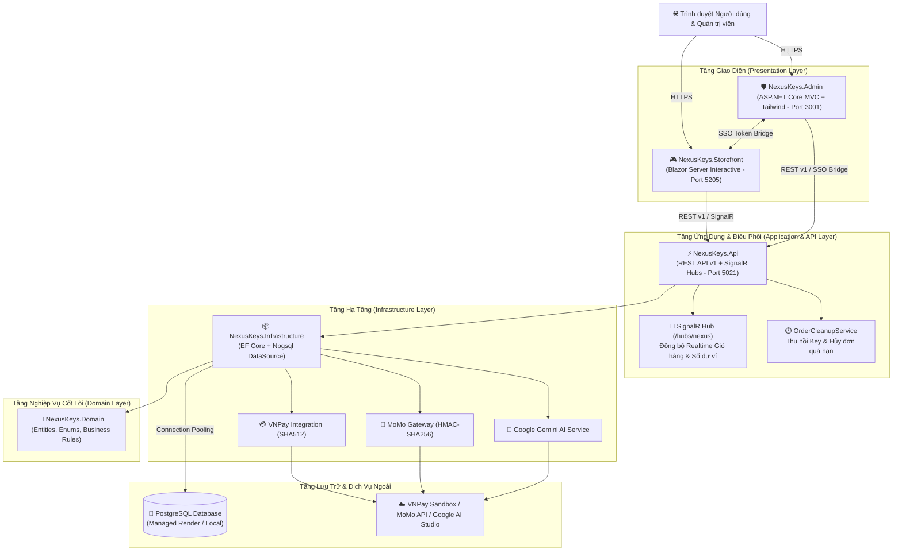

# 🎮 NexusKeys — Nền tảng Phân phối Game Bản quyền & License Key Trực tuyến

<p align="center">
  
</p>

<p align="center">
  <strong>Đồ án Tốt nghiệp (Graduation Thesis) — Hệ thống Thương Mại Điện Tử Phân Phối Game Kỹ Thuật Số & License Key Tự Động</strong>
</p>

<p align="center">
  
  
  
  
  
  
  
  
  
</p>

---

## 📖 1. Giới thiệu Tổng quan (Project Overview)

**NexusKeys** là hệ thống thương mại điện tử chuyên biệt phục vụ phân phối bản quyền trò chơi điện tử và phần mềm kỹ thuật số trực tuyến. Hệ thống giải quyết trọn vẹn bài toán từ khâu khám phá sản phẩm, giao dịch thanh toán đa kênh tự động, kích hoạt và bàn giao License Key tức thì theo thời gian thực (Zero Key-Collision), cho đến quản lý hậu mãi và tích hợp trợ lý trí tuệ nhân tạo (AI Copilot) hỗ trợ người mua.

### 🎯 Điểm nổi bật của đề tài:
- **Kiến trúc Clean Architecture đa tầng:** Phân tách rõ ràng giữa Core Business Rules, Infrastructure, API Contract và Presentation Layers.
- **Giao License Key tức thì & Chống bán trùng:** Cơ chế giữ chỗ (reserve), khóa bi quan/lạc quan (concurrency control) đảm bảo không bao giờ phát hành trùng lặp mã kích hoạt.
- **Tự động hóa hoàn tiền / hủy đơn hết hạn:** `OrderCleanupService` chạy ngầm giải phóng key và hủy đơn hàng quá hạn 15 phút chưa thanh toán.
- **Thanh toán đa cổng tích hợp:** Hỗ trợ **VNPay** (Sandbox VNPAY-QR, Thẻ nội địa ATM, Thẻ quốc tế), **MoMo Gateway**, và **Ví điện tử nội bộ NexusPay**.
- **Trợ lý ảo AI Copilot:** Tích hợp **Google Gemini AI** hỗ trợ tra cứu thông số game, tư vấn cấu hình phần cứng phù hợp và giải đáp thắc mắc khách hàng.
- **Trải nghiệm Single Sign-On (SSO Bridge):** Đồng bộ phiên đăng nhập liền mạch giữa Web Khách hàng (Storefront) và Cổng Quản trị (Admin Portal).
- **Hệ thống Kiểm thử vững chắc:** Bộ 72 bài kiểm thử tự động (Contract Tests, Unit Tests, Integration Tests) đảm bảo chất lượng vận hành 100%.

---

## 🏗️ 2. Kiến trúc Hệ thống (System Architecture)

Dự án được xây dựng theo chuẩn **Clean Architecture** kết hợp mô hình phân tán dịch vụ (Modular Monolith / Service-Oriented):



### 📂 Cấu trúc Thư mục Solution:

```text
datn/
├── src/
│   ├── NexusKeys.Domain/            # Thực thể lõi (User, Product, Order, ProductKey, Review, Coupon...)
│   │   ├── Entities/                # Domain Entities có quan hệ chặt chẽ
│   │   └── Enums/                   # Trạng thái đơn hàng, phân quyền, trạng thái key
│   ├── NexusKeys.Infrastructure/    # Cài đặt công nghệ & Dịch vụ ngoài
│   │   ├── Data/                    # GameStoreDbContext, DbInitializer (Seed 29 games & accounts)
│   │   ├── BackgroundTasks/         # OrderCleanupService (Worker tự động thu hồi key sau 15p)
│   │   └── Services/                # Tích hợp VNPay, MoMo, Gemini AI, Email SMTP
│   ├── NexusKeys.Api/               # REST API Endpoint v1 theo chuẩn RFC 7807
│   │   ├── Endpoints/               # Identity, Products, Orders, Checkout, Wishlist, Reviews...
│   │   ├── Hubs/                    # SignalR Hubs phục vụ thông báo trực tiếp
│   │   └── Middleware/              # ErrorHandlingMiddleware, RateLimiting, BearerAuth
│   ├── NexusKeys.Storefront/        # Web Bán Hàng Khách Hàng (Blazor Server .NET 10)
│   │   ├── Components/Pages/        # Home, Products, ProductDetail, Cart, Checkout, Profile, Library
│   │   ├── ViewModels/              # MVVM State Management (Auth, Cart, Wishlist, Product)
│   │   └── wwwroot/                 # Stylesheet Dark theme, Google SSO Interop, Admin Bridge
│   └── NexusKeys.Admin/             # Cổng Quản Trị Hệ Thống (ASP.NET Core MVC)
│       ├── Controllers/             # Dashboard, Products, Orders, Keys, Users, Coupons, Support
│       ├── Views/                   # Giao diện quản trị hiện đại (Tailwind CSS, FontAwesome 6)
│       └── Middleware/              # AdminAuthMiddleware, RBAC Access Verification
├── tests/
│   └── GameStore.API.ProductKeyTests/ # 72 Unit, Contract & Integration Tests tự động
├── docs/
│   ├── REST_API_V1.md               # Đặc tả chi tiết chuẩn hợp đồng RESTful API v1
│   ├── NEXUS_UI.md                  # Hướng dẫn Design System & Tokens giao diện
│   └── UI_UX_MASTER_PLAN.md         # Báo cáo đánh giá và kế hoạch tối ưu trải nghiệm người dùng
├── Dockerfile.api                   # Multi-stage Dockerfile cho Backend REST API
├── Dockerfile.frontend              # Multi-stage Dockerfile cho Storefront Blazor
├── Dockerfile.backend               # Multi-stage Dockerfile cho Admin Management Portal
├── render.yaml                      # Render Infrastructure as Code (Blueprint)
└── GameStore.slnx                   # File Solution điều phối toàn bộ dự án
```

---

## ✨ 3. Các Phân hệ & Tính năng Chi tiết (Core Modules)

### 3.1. Phân hệ Web Khách hàng (Customer Storefront)
- **Giao diện Gaming Dark-Theme cao cấp:** Thiết kế tối ưu theo ngôn ngữ Epic Games Store / Steam, hỗ trợ chuẩn WCAG 2.1 AA.
- **Khám phá Danh mục Sản phẩm:**
  - Hero Carousel tự động chuyển slide các tựa game bom tấn.
  - Bộ sưu tập Flash Sale, Top Bán Chạy, Game Mới Phát Hành, Trò chơi Miễn phí.
  - Bộ lọc đa chiều: Tìm kiếm tức thời (Debounced Search), lọc theo thể loại (Action, RPG, Strategy...), khoảng giá và hệ điều hành (Windows, macOS, Linux).
- **Trang Chi tiết Trò chơi (Product Details):**
  - Gallery truyền thông: Trailer video YouTube nhúng, ảnh chụp màn hình độ phân giải cao.
  - Bảng cấu hình phần cứng chi tiết: Tối thiểu (Minimum) & Đề nghị (Recommended) bao gồm CPU, GPU, RAM, DirectX, dung lượng ổ cứng.
  - Đánh giá sao (1-5 sao) và mục bình luận trao đổi giữa các game thủ.
- **Quy trình Mua hàng & Thanh toán (Cart & Checkout):**
  - Giỏ hàng thời gian thực: Áp dụng mã Voucher / Coupon giảm giá theo % hoặc tiền mặt cố định.
  - Đa kênh thanh toán tự động:
    - **VNPay Sandbox:** Quét mã VNPAY-QR, thẻ ATM nội địa tất cả ngân hàng, thẻ quốc tế.
    - **MoMo Gateway:** Cổng ví MoMo với chữ ký số HMAC-SHA256 bảo mật.
    - **Ví nội bộ NexusPay:** Thanh toán tức thời trừ trực tiếp từ số dư tài khoản người dùng.
- **Kho Game Cá Nhân & Quản lý Bản Quyền (My Library):**
  - Lưu trữ vĩnh viễn các tựa game đã mua kèm mã Serial / License Key.
  - Tính năng **Ẩn/Hiện License Key (Mask/Reveal)** và nút **Copy 1-Click** tiện lợi, bảo mật.
- **Trung tâm Tài khoản (User Dashboard):**
  - Xem và cập nhật thông tin cá nhân, thay đổi mật khẩu, theo dõi lịch sử đơn hàng và biến động số dư ví.
  - Chức năng nạp tiền ví NexusPay trực tuyến.
- **Trợ lý AI Trò chơi (Gemini AI Assistant):**
  - Tích hợp mô hình Gemini AI giúp người chơi kiểm tra xem cấu hình máy của mình có chơi mượt tựa game mong muốn hay không, gợi ý game tương đồng theo sở thích.

---

### 3.2. Phân hệ Quản trị Hệ thống (Admin Management Portal)
- **Bảng điều khiển Thống kê (Dashboard Analytics):**
  - Biểu đồ tổng doanh thu theo chu kỳ, số đơn hàng thành công, số người dùng mới đăng ký.
  - Cảnh báo tự động lượng License Key sắp hết trong kho (Low-Stock Alerts).
- **Quản lý Sản phẩm (Catalog Management):**
  - Thêm mới, chỉnh sửa, ẩn/hiện sản phẩm game và phần mềm.
  - Quản lý media, ảnh bìa capsule, ảnh hero, thông số cấu hình phần cứng chi tiết.
- **Quản lý Kho License Key (Digital Key Vault):**
  - Nhập key hàng loạt (Batch Import), phân loại theo từng game.
  - Quản lý trạng thái key: `Available` (sẵn sàng), `Sold` (đã bàn giao), `Revoked` (thu hồi).
  - Tự động gán mã bản quyền cho khách hàng ngay khi cổng thanh toán xác nhận thành công (IPN).
- **Quản lý Đơn hàng (Orders Management):**
  - Theo dõi danh sách đơn hàng toàn hệ thống (`Pending`, `Completed`, `Failed`, `Cancelled`).
  - Xem chi tiết từng hóa đơn, mã giao dịch cổng thanh toán và danh sách License Key đã xuất.
- **Quản lý Người dùng & Phân quyền (RBAC):**
  - Phân cấp 4 vai trò: `Administrator` (toàn quyền), `Developer` (quản lý game phát hành), `Staff` (vận hành đơn & hỗ trợ), `Customer` (khách mua hàng).
  - Khóa (Lock) hoặc mở khóa tài khoản người dùng vi phạm chính sách.
- **Khuyến mãi & Mã giảm giá (Coupons & Promotions):**
  - Thiết lập chiến dịch giảm giá, tạo mã voucher theo % hoặc số tiền cố định, cấu hình số lượt sử dụng tối đa và thời gian hiệu lực.
- **Trung tâm Hỗ trợ Khách hàng (Support Ticket System):**
  - Tiếp nhận khiếu nại, sự cố kích hoạt key từ khách hàng.
  - Nhân viên quản trị phản hồi và cập nhật trạng thái phiếu hỗ trợ trực tiếp.
- **Nhật ký Kiểm toán (Audit Logs):**
  - Ghi nhận lịch sử mọi thao tác nhạy cảm: thay đổi giá, xuất key thủ công, sửa thông tin người dùng, điều chỉnh cấu hình hệ thống.
- **Cấu hình Độc lập & Tích hợp:**
  - Trang đăng nhập độc lập có sẵn tính năng **👑 1-Click Demo Admin** để kiểm tra nhanh hệ thống.

---

### 3.3. Phân hệ Backend RESTful API & Dịch vụ Nền tảng (NexusKeys.Api)
- **RESTful API v1 Chuẩn mực:**
  - Toàn bộ endpoint được định tuyến tường minh qua tiền tố `/api/v1/...`.
  - Phản hồi lỗi chuẩn định dạng RFC 7807 `application/problem+json` kèm `traceId` hỗ trợ gỡ lỗi.
- **Bảo mật & Xác thực:**
  - Cơ chế JSON Web Token (JWT) Bearer kết hợp Refresh Token lưu trữ bảo mật.
  - Tích hợp Google Identity Services (OAuth 2.0 Google SSO).
  - Băm mật khẩu bằng thuật toán công nghiệp **BCrypt**.
- **Xử lý Đơn hàng Ngầm (Background Order Cleanup Service):**
  - Background Service chạy định kỳ quét các đơn hàng ở trạng thái `Pending` quá hạn 15 phút.
  - Tự động thu hồi các License Key đã tạm khóa (reservation) trở về kho chung và đánh dấu đơn hàng `Failed`.
- **Kênh Truyền Thông Thời Gian Thực (SignalR):**
  - Endpoint WebSocket `/hubs/nexus` truyền dữ liệu biến động tức thì tới giao diện người dùng.

---

## 👑 4. Tài khoản Demo Trải Nghiệm Nhanh (Demo Accounts)

Hệ thống đã nạp sẵn dữ liệu mẫu (Seeded Data) với 29 tựa game bom tấn và các tài khoản phân quyền đầy đủ số dư:

| Vai trò | Email đăng nhập | Mật khẩu | Số dư ví | Quyền hạn chính |
| :--- | :--- | :---: | :---: | :--- |
| **Administrator** | `admin@nexuskeys.com` | `Admin123!` | 50.000.000 đ | Toàn quyền quản trị Store, Admin Portal, Kho Key, User, Doanh thu |
| **Staff** | `staff@nexuskeys.com` | `Staff123!` | 20.000.000 đ | Quản trị đơn hàng, duyệt kho key, hỗ trợ khách hàng |
| **Developer** | `dev@cdprojekt.com` | `Dev123!` | 12.000.000 đ | Quản lý danh mục game phát hành và báo cáo doanh số |
| **Customer** | `gamer99@gmail.com` | `User123!` | 2.500.000 đ | Mua sắm game, nạp ví, kích hoạt key, viết đánh giá |

> [!TIP]
> **Đăng nhập 1-Click thuận tiện khi chấm điểm / đánh giá:**  
> Tại trang đăng nhập của cả **Storefront** (`/login`) lẫn **Admin Portal** (`/Auth/Login`), hệ thống đều tích hợp sẵn nút bấm **"👑 Đăng nhập Demo Admin (1-Click)"** giúp đăng nhập ngay lập tức vào vai trò Administrator mà không cần gõ tay tài khoản.

---

## 🚀 5. Hướng dẫn Khởi chạy ở Môi trường Local (Getting Started)

### 5.1. Yêu cầu Tiên quyết (Prerequisites)
- [.NET 10.0 SDK](https://dotnet.microsoft.com/download/dotnet/10.0)
- [PostgreSQL 16+](https://www.postgresql.org/download/) (hoặc sử dụng dịch vụ PostgreSQL Cloud như Render/Supabase)
- [Git](https://git-scm.com/)

### 5.2. Các bước Cài đặt & Khởi chạy

#### Bước 1: Clone kho mã nguồn
```bash
git clone https://github.com/kynhungvanlaky-max/StoreApp.git
cd StoreApp
```

#### Bước 2: Cấu hình Chuỗi kết nối Cơ sở dữ liệu
Bạn có thể cấu hình thông qua biến môi trường `DATABASE_URL` hoặc `ConnectionStrings:DefaultConnection`:
```powershell
# Ví dụ cấu hình biến môi trường PostgreSQL trong PowerShell:
$env:DATABASE_URL = "Host=localhost;Port=5432;Database=gamestore_db;Username=postgres;Password=YourPassword;SSL Mode=Prefer;"
```

#### Bước 3: Biên dịch toàn bộ Solution & Kiểm thử
```powershell
# Build toàn bộ các project
dotnet build GameStore.slnx

# Chạy toàn bộ 72 Unit & Integration Tests
dotnet test tests/GameStore.API.ProductKeyTests/GameStore.API.ProductKeyTests.csproj
```

#### Bước 4: Khởi chạy đồng thời 3 dịch vụ

Mở 3 cửa sổ terminal riêng biệt và thực thi các lệnh sau:

* **Terminal 1 — Backend REST API (Port 5021):**
  ```powershell
  dotnet run --project src/NexusKeys.Api/NexusKeys.Api.csproj --urls "http://localhost:5021"
  ```
  *(Khi khởi động lần đầu, hệ thống sẽ tự động khởi tạo bảng và seed 29 game mẫu cùng các tài khoản demo)*

* **Terminal 2 — Customer Storefront (Port 5205):**
  ```powershell
  $env:ApiSettings__BaseUrl = "http://localhost:5021/"
  dotnet run --project src/NexusKeys.Storefront/NexusKeys.Storefront.csproj --urls "http://localhost:5205"
  ```

* **Terminal 3 — Admin Management Portal (Port 3001):**
  ```powershell
  $env:ApiSettings__BaseUrl = "http://localhost:5021/"
  $env:AppSettings__FrontendBaseUrl = "http://localhost:5205"
  dotnet run --project src/NexusKeys.Admin/NexusKeys.Admin.csproj --urls "http://localhost:3001"
  ```

Sau khi chạy, truy cập trình duyệt tại:
- **Web Mua Hàng:** [http://localhost:5205](http://localhost:5205)
- **Trang Đăng Nhập:** [http://localhost:5205/login](http://localhost:5205/login)
- **Cổng Quản Trị:** [http://localhost:3001](http://localhost:3001)
- **API Swagger / Endpoint:** [http://localhost:5021/api/v1/products](http://localhost:5021/api/v1/products)

---

## ☁️ 6. Hướng dẫn Triển khai Cloud (Cloud Deployment Guide)

Dự án đã sẵn sàng triển khai tự động lên nền tảng đám mây **Render** qua tệp cấu hình **Infrastructure as Code** [`render.yaml`](render.yaml).

### Kiến trúc Triển khai trên Render:
1. **Database:** PostgreSQL Managed Service (`gamestore-db`).
2. **API Service:** Web Service Docker `nexuskeys-api` (`Dockerfile.api`).
3. **Storefront Service:** Web Service Docker `nexuskeys-storefront` (`Dockerfile.frontend`).
4. **Admin Portal Service:** Web Service Docker `nexuskeys-admin` (`Dockerfile.backend`).

### Các biến môi trường cần lưu ý trên Render:

| Service | Tên Biến Môi Trường | Giá trị chuẩn | Mục đích |
| :--- | :--- | :--- | :--- |
| **`nexuskeys-api`** | `DATABASE_URL` | Auto linked từ `gamestore-db` | Kết nối CSDL PostgreSQL |
| **`nexuskeys-api`** | `Jwt__Key` | Chuỗi bí mật >= 32 ký tự | Ký mã hóa JWT Token |
| **`nexuskeys-storefront`** | `ApiSettings__BaseUrl` | `https://nexuskeys-api.onrender.com/` | Gọi Backend REST API |
| **`nexuskeys-storefront`** | `AdminPortal__BaseUrl` | `https://nexuskeys-admin.onrender.com/` | SSO Bridge vào Admin |
| **`nexuskeys-admin`** | `ApiSettings__BaseUrl` | `https://nexuskeys-api.onrender.com/` | Admin xác thực & lấy dữ liệu |
| **`nexuskeys-admin`** | `AppSettings__FrontendBaseUrl` | `https://nexuskeys-storefront.onrender.com/` | Chuyển tiếp người dùng về Web |

---

## 🧪 7. Kiểm thử & Đảm bảo Chất lượng (Testing & QA)

Dự án áp dụng quy trình kiểm thử tự động nghiêm ngặt với **72 bài test** được cấu hình trong `tests/GameStore.API.ProductKeyTests`:

```text
Passed!  - Failed: 0, Passed: 72, Skipped: 0, Total: 72 (100% Passed)
```

### Các nhóm kiểm thử chính:
- **Contract Tests (Đặc tả Hợp đồng REST API v1):** Xác thực định dạng route `/api/v1/...`, cấu trúc ProblemDetails RFC 7807, mã trạng thái HTTP (200, 201, 204, 400, 401, 403, 404, 409).
- **Concurrency & Key-Reservation Tests:** Kiểm thử khả năng chịu tải khi nhiều người dùng cùng bấm mua chiếc key cuối cùng của một tựa game (ngăn chặn Race Condition và Double-Spending).
- **Payment Lifecycle Tests:** Kiểm thử toàn bộ vòng đời đơn hàng: Tạo đơn $\rightarrow$ Chờ thanh toán $\rightarrow$ Xác nhận IPN $\rightarrow$ Bàn giao License Key $\rightarrow$ Hủy đơn khi quá hạn.
- **Role-Based Access Control (RBAC) Tests:** Đảm bảo khách hàng không thể can thiệp vào các tài nguyên quản trị, kho key hoặc đơn hàng của người khác.

---

## 📚 8. Tài liệu Kỹ thuật Tham khảo

- [Đặc tả Hợp đồng REST API v1 (docs/REST_API_V1.md)](docs/REST_API_V1.md): Chi tiết từng Endpoint, Request/Response payload mẫu.
- [Hệ thống Thiết kế Nexus UI (docs/NEXUS_UI.md)](docs/NEXUS_UI.md): Bảng mã màu, kiểu chữ, Design Tokens.
- [Kế hoạch Điều phối UI/UX Toàn diện (docs/UI_UX_MASTER_PLAN.md)](docs/UI_UX_MASTER_PLAN.md): Báo cáo tiêu chuẩn tiếp cận WCAG 2.1 AA.

---

## 👥 9. Thông tin Đồ án & Tác giả (Thesis Information)

- **Đề tài:** Xây dựng hệ thống thương mại điện tử phân phối game bản quyền và license key trực tuyến NexusKeys.
- **Hệ thống:** Clean Architecture, .NET 10, Blazor Server, ASP.NET Core MVC, PostgreSQL, Docker.
- **Mã nguồn:** [GitHub Repository](https://github.com/kynhungvanlaky-max/StoreApp)
- **Bản quyền:** © 2026 NexusKeys. Mọi quyền được bảo lưu.
