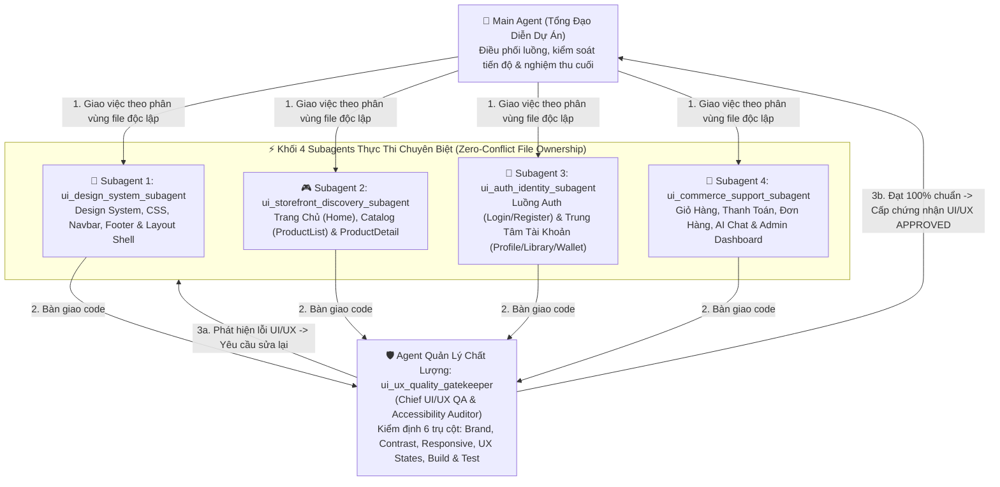

# NEXUSKEYS GAME STORE — BÁO CÁO KIỂM ĐỊNH & KẾ HOẠCH ĐIỀU PHỐI TỔNG THỂ UI/UX (UI/UX MASTER PLAN)

> **Phiên bản**: 2.0 (Chuẩn hóa Kiến trúc Đa Tác Nhân - Multi-Agent UI/UX Governance)  
> **Dự án**: DATN — NexusKeys Game Store (`NexusKeys.Storefront` & `NexusKeys.Admin`)  
> **Mục tiêu**: Chuẩn hóa 100% nhận diện thương hiệu NexusKeys, tối ưu hóa trải nghiệm người dùng (UX), đảm bảo khả năng tiếp cận (WCAG 2.1 AA) và vận hành qua mô hình **4 Subagents Thực Thi + 1 Agent Quản Lý Chất Lượng Độc Lập (`ui_ux_quality_gatekeeper`)**.

---

## 1. BÁO CÁO KIỂM ĐỊNH THỰC TRẠNG UI/UX (UI/UX AUDIT REPORT)

Qua quá trình rà soát toàn bộ mã nguồn giao diện (`src/NexusKeys.Storefront` và `src/NexusKeys.Admin`) cùng tài liệu thiết kế [`docs/NEXUS_UI.md`](NEXUS_UI.md), hệ thống hiện tại có nền tảng bố cục tốt nhưng đang tồn tại **5 nhóm vấn đề cốt lõi** làm giảm tính chuyên nghiệp và trải nghiệm người dùng:

### 1.1. Phân mảnh thương hiệu & Bất nhất ngôn ngữ (Brand & Localization Split-Brain)
* **Hiện trạng**: Giao diện đang bị chia cắt giữa thương hiệu **NexusKeys (Tiếng Việt)** và bản mẫu **Epic Games Store (Tiếng Anh)**:
  * **Các trang Xác thực (`Login.razor`, `Register.razor`, `ForgotPassword.razor`, `ResetPassword.razor`)**: Toàn bộ nhãn, tiêu đề, thông báo hướng dẫn đang hiển thị 100% bằng Tiếng Anh (*"Sign in to Epic Games"*, *"Create an Epic Games Account"*, *"Only played on console?"*, *"Email address"*, *"Password"*) và dùng ảnh tĩnh `images/epic/epic_logo.png` lệch tông hoàn toàn với thanh điều hướng `NEXUSKEYS`.
  * **Chân trang (`Footer.razor`)**: Các cột liên kết (*"Resources"*, *"Made by Epic Games"*, *"Terms of Service"*, *"Privacy Policy"*) và dòng bản quyền vẫn giữ nguyên văn bản tiếng Anh của Epic Games, trong khi hộp thoại *Tùy Chọn Cookie* bên trong lại dùng Tiếng Việt.
  * **Tiêu đề trang (`<PageTitle>`) & Tiêu đề mục**:
    * `Home.razor` (dòng 6, 186): `<PageTitle>Epic Games Store | Official Storefront</PageTitle>`, tiêu đề mục `"Featured Discounts"` chưa được Việt hóa.
    * `ProductList.razor` (dòng 6): `<PageTitle>Browse Games | Epic Games Store</PageTitle>`.
    * `ProductDetail.razor` (dòng 15), `NewsList.razor` (dòng 8), `Assistant.razor` (dòng 6): Vẫn mang hậu tố `| Epic Games Store`.
    * `ProfileLayout.razor` (dòng 18): Hiển thị dòng chữ `"Epic Games Store Ecosystem"`.

### 1.2. Xung đột Kiến trúc CSS & Design Tokens (Stylesheet & Token Fragmentation)
* **Hiện trạng**:
  * Tài liệu [`docs/NEXUS_UI.md`](NEXUS_UI.md) quy định sử dụng `css/nexus-ui.css` (với biến `--nui-*` và font `Be Vietnam Pro`).
  * Tuy nhiên, [`App.razor`](../src/NexusKeys.Storefront/Components/App.razor) đang nạp chồng chéo 3 bộ CSS lớn: `css/site.css`, `css/epic-games.css` (2,027 dòng) và `design/atlas.css` (2,979 dòng), đồng thời gắn cứng inline style `font-family: 'Inter'` trên thẻ `<body>`, trong khi `nexus-ui.css` (4,028 dòng) bị bỏ quên.
  * Thành phần [`Sidebar.razor`](../src/NexusKeys.Storefront/Components/Layout/Sidebar.razor) dùng hệ class DaisyUI cũ (`bg-base-200`, `text-base-content`) bị dư thừa, không được sử dụng trong `MainLayout.razor`.

### 1.3. Điểm nghẽn Luồng Tương tác & Chuyển đổi Mua hàng (UX Flow & Conversion Bottlenecks)
* **Trang chủ (`Home.razor`)**:
  * Các nút **Bookmark / Yêu thích** trên thẻ game ở trang chủ (dòng 101, 116, 131, 146, 206, 223, 240...) mới chỉ chặn sự kiện mặc định (`@onclick:preventDefault="true"`) nhưng **chưa gắn hàm xử lý thực tế** (`WishlistViewModel` + `ToastService`). Người dùng nhấn vào không có bất kỳ phản hồi nào.
* **Thanh tìm kiếm thông minh (`Navbar.razor`)**:
  * Dropdown kết quả tìm kiếm nhanh (dòng 71–91) chỉ hiển thị tên game và nhãn phụ *"Trò chơi cơ bản"*, **thiếu thông tin Giá bán / % Giảm giá**, làm giảm hiệu quả ra quyết định của người mua.
  * Ô tìm kiếm trên giao diện Mobile (dòng 190–193) chưa hiển thị danh sách kết quả gợi ý tức thời như trên Desktop.
* **Luồng Giỏ hàng & Thanh toán (`Cart.razor` $\rightarrow$ `Checkout.razor` $\rightarrow$ `CheckoutSuccess.razor`)**:
  * Thiếu thanh tiến trình trực quan (Step Progress Indicator: `1. Giỏ hàng` $\rightarrow$ `2. Thanh toán` $\rightarrow$ `3. Nhận bản quyền`) để định vị bước hiện tại của khách hàng.

### 1.4. Khả năng Tiếp cận (Accessibility - WCAG 2.1 AA) & Vùng chạm Di động (Touch Targets)
* **Độ tương phản văn bản (Color Contrast)**:
  * Nhiều nhãn phụ, thông tin ngày tháng, hướng dẫn dùng class `text-white/30` và `text-white/40` trên nền tối `#18181c` / `#202024` có độ tương phản chỉ đạt **2.3:1 – 3.1:1**, thấp hơn ngưỡng chuẩn WCAG 2.1 AA (**4.5:1**), gây mỏi mắt khi đọc.
* **Kích thước vùng chạm (Tap Targets)**:
  * Các nút điều hướng carousel (`.egs-circle-btn`), nút xóa bộ lọc (`w-3 h-3`), nút đóng modal (`w-7 h-7`, `w-8 h-8`) có diện tích nhỏ hơn chuẩn khuyến nghị `36px–44px` trên màn hình cảm ứng.

### 1.5. Đồng bộ Trải nghiệm Quản trị (`NexusKeys.Admin`)
* Trên trang tổng quan [`Views/Home/Index.cshtml`](../src/NexusKeys.Admin/Views/Home/Index.cshtml) (dòng 71), cột trạng thái đơn hàng gần đây đang in trực tiếp chuỗi tiếng Anh thô (`Completed`, `Pending`, `Failed`) thay vì sử dụng Badge trạng thái tiếng Việt có màu sắc phân biệt rõ ràng như ở Storefront.

---

## 2. KIẾN TRÚC ĐỘI NGŨ SUBAGENTS & AGENT QUẢN LÝ CHẤT LƯỢNG UI/UX

Để đảm bảo quá trình nâng cấp diễn ra nhanh, sạch, **không giẫm chân lên file của nhau (Zero Merge Conflict)** và đạt chất lượng cao nhất, hệ thống được chia thành **1 Tổng Đạo Diễn (Main Orchestrator)**, **4 Subagents Thực Thi** và **1 Agent Quản Lý Chất Lượng UI/UX (`ui_ux_quality_gatekeeper`)**.

---

## 3. MA TRẬN PHÂN CÔNG NHIỆM VỤ & QUYỀN SỞ HỮU FILE ĐỘC LẬP (WORK BREAKDOWN MATRIX)

> [!IMPORTANT]
> **Nguyên tắc Cô lập Vùng làm việc (Strict File Isolation)**: Mỗi Subagent chỉ được phép chỉnh sửa các file nằm trong danh sách được phân công dưới đây để tuyệt đối không xảy ra xung đột khi chạy song song hoặc tuần tự.

### 🎨 Subagent 1: `ui_design_system_subagent`
* **Vai trò**: Kiến trúc sư Design System, Navigation Shell & Footer.
* **Phạm vi file độc quyền**:
  * `src/NexusKeys.Storefront/Components/App.razor`
  * `src/NexusKeys.Storefront/Components/Layout/MainLayout.razor`
  * `src/NexusKeys.Storefront/Components/Layout/Navbar.razor`
  * `src/NexusKeys.Storefront/Components/Layout/Footer.razor`
  * `src/NexusKeys.Storefront/Components/Layout/ToastContainer.razor`
  * `src/NexusKeys.Storefront/wwwroot/css/*`
* **Danh sách đầu việc (Action Items)**:
  1. **Chuẩn hóa `Navbar.razor`**:
     * Hiển thị thêm **Giá sản phẩm / Nhãn giảm giá** bên cạnh tên game trong khung gợi ý tìm kiếm nhanh (Live Search Dropdown).
     * Bổ sung hiển thị kết quả gợi ý tìm kiếm trên cả chế độ Mobile Menu.
     * Đảm bảo các nút icon (Yêu thích, Giỏ hàng, Tài khoản) có hiệu ứng `focus-visible` và vùng bấm đạt chuẩn.
  2. **Việt hóa & Đồng bộ thương hiệu `Footer.razor`**:
     * Chuyển toàn bộ các mục *"Resources"*, *"Made by Epic Games"*, *"Terms of Service"*, *"Privacy Policy"*, *"Store Refund Policy"*, *"Cookie Preferences"* và văn bản bản quyền sang Tiếng Việt chuẩn thương hiệu **NexusKeys**.
  3. **Tinh chỉnh `App.razor` & CSS**:
     * Đồng bộ hóa khai báo font chữ và biến màu nền/chữ chuẩn của NexusKeys, loại bỏ các khai báo dư thừa gây xung đột.

---

### 🎮 Subagent 2: `ui_storefront_discovery_subagent`
* **Vai trò**: Chuyên gia Trải nghiệm Khám phá Cửa hàng & Chi tiết Sản phẩm.
* **Phạm vi file độc quyền**:
  * `src/NexusKeys.Storefront/Components/Pages/Home.razor`
  * `src/NexusKeys.Storefront/Components/Pages/Products/ProductList.razor`
  * `src/NexusKeys.Storefront/Components/Pages/Products/ProductDetail.razor`
  * `src/NexusKeys.Storefront/Components/Shared/ProductCard.razor`
  * `src/NexusKeys.Storefront/Components/Shared/ProductImage.razor`
* **Danh sách đầu việc (Action Items)**:
  1. **Nâng cấp toàn diện `Home.razor`**:
     * Đổi `<PageTitle>` thành `"NexusKeys | Cửa Hàng Game Bản Quyền Chính Hãng"`.
     * Việt hóa toàn bộ các tiêu đề section còn sót tiếng Anh (ví dụ: `"Featured Discounts"` $\rightarrow$ `"Ưu Đãi Giảm Giá Nổi Bật"`).
     * Gắn kết sự kiện tương tác thực tế cho các nút **Thêm vào danh sách ước (Bookmark)** trên trang chủ (hiển thị Toast thông báo trạng thái rõ ràng hoặc điều hướng thông minh).
  2. **Tối ưu `ProductList.razor` & `ProductCard.razor`**:
     * Đổi `<PageTitle>` thành `"Kho Game Bản Quyền — NexusKeys"`.
     * Nâng độ tương phản của các văn bản phụ (`text-white/40` $\rightarrow$ `text-white/65`) để dễ đọc hơn trên mọi màn hình.
     * Cải thiện vùng chạm cho các chip bộ lọc (Filter Chips) và nút phân trang.
  3. **Tinh chỉnh `ProductDetail.razor`**:
     * Đổi hậu tố `<PageTitle>` từ `| Epic Games Store` thành `— NexusKeys`.
     * Tối ưu bố cục khối Mua hàng / Thêm giỏ hàng (Sticky Purchase Box) và độ tương phản khu vực Đánh giá (Reviews) & Cấu hình yêu cầu.

---

### 🔐 Subagent 3: `ui_auth_identity_subagent`
* **Vai trò**: Chuyên gia UI/UX Xác thực, Onboarding & Trung tâm Tài khoản.
* **Phạm vi file độc quyền**:
  * `src/NexusKeys.Storefront/Components/Pages/Auth/Login.razor`
  * `src/NexusKeys.Storefront/Components/Pages/Auth/Register.razor`
  * `src/NexusKeys.Storefront/Components/Pages/Auth/ForgotPassword.razor`
  * `src/NexusKeys.Storefront/Components/Pages/Auth/ResetPassword.razor`
  * `src/NexusKeys.Storefront/Components/Layout/ProfileLayout.razor`
  * `src/NexusKeys.Storefront/Components/Pages/Profile/Profile.razor`
  * `src/NexusKeys.Storefront/Components/Pages/Profile/Library.razor`
  * `src/NexusKeys.Storefront/Components/Pages/Profile/Wallet.razor`
* **Danh sách đầu việc (Action Items)**:
  1. **Việt hóa 100% & Đồng bộ thương hiệu trên 4 trang Auth (`Login`, `Register`, `ForgotPassword`, `ResetPassword`)**:
     * Thay thế logo tĩnh `epic_logo.png` bằng cụm nhận diện thương hiệu **NEXUSKEYS** đồng bộ với Navbar.
     * Chuyển toàn bộ giao diện tiếng Anh (*"Sign in to Epic Games"*, *"Create an Epic Games Account"*, *"Email address"*, *"Password"*, *"Forgot password?"*, *"Continue"*, *"New here? Create an account"*, *"Only played on console?"*, *"Other ways to sign in"*) sang Tiếng Việt chuẩn mực, hiện đại.
     * **Lưu ý kỹ thuật**: Giữ nguyên tuyệt đối các thuộc tính `id`, `type`, `@bind` và cấu trúc form để đảm bảo tương thích 100% với bộ kiểm thử tự động.
  2. **Chuẩn hóa Trung tâm Tài khoản (`ProfileLayout`, `Profile`, `Library`, `Wallet`)**:
     * Trong `ProfileLayout.razor`: Đổi `"Epic Games Store Ecosystem"` thành `"Hệ Sinh Thái Bản Quyền NexusKeys"`.
     * Trong `Library.razor`, `Profile.razor`, `Wallet.razor`: Nâng cao độ tương phản của các nhãn hướng dẫn mờ (`text-white/30`, `text-white/40` $\rightarrow$ `text-white/60`), tối ưu trải nghiệm hiển thị & sao chép mã License Key trên thiết bị di động.

---

### 🛒 Subagent 4: `ui_commerce_support_subagent`
* **Vai trò**: Chuyên gia Luồng Thanh toán, Đơn hàng, Hỗ trợ AI & Đồng bộ Admin Portal.
* **Phạm vi file độc quyền**:
  * `src/NexusKeys.Storefront/Components/Pages/Cart/Cart.razor`
  * `src/NexusKeys.Storefront/Components/Pages/Checkout/Checkout.razor`
  * `src/NexusKeys.Storefront/Components/Pages/Checkout/CheckoutSuccess.razor`
  * `src/NexusKeys.Storefront/Components/Pages/Orders/OrderList.razor`
  * `src/NexusKeys.Storefront/Components/Pages/Orders/OrderDetail.razor`
  * `src/NexusKeys.Storefront/Components/Pages/Wishlist/Wishlist.razor`
  * `src/NexusKeys.Storefront/Components/Pages/News/NewsList.razor` & `NewsDetail.razor`
  * `src/NexusKeys.Storefront/Components/Pages/Support.razor`, `Assistant.razor`, `Components/Layout/ChatWidget.razor`
  * `src/NexusKeys.Storefront/Components/Pages/Distribution.razor`, `Creator.razor`, `Careers.razor`, `Policies.razor`, `Download.razor`
  * `src/NexusKeys.Admin/Views/Home/Index.cshtml`
* **Danh sách đầu việc (Action Items)**:
  1. **Tối ưu hóa Phễu Thanh toán (`Cart.razor`, `Checkout.razor`, `CheckoutSuccess.razor`)**:
     * Bổ sung **Thanh Tiến Trình Mua Hàng (Checkout Stepper)**: `1. Giỏ hàng` $\rightarrow$ `2. Thanh toán` $\rightarrow$ `3. Hoàn tất & Nhận Key` giúp người dùng nắm rõ vị trí trong luồng giao dịch.
     * Cải thiện độ tương phản và phản hồi trạng thái khi áp dụng mã giảm giá (Coupon) và chọn cổng thanh toán.
  2. **Đồng bộ thương hiệu các trang Nội dung & Trợ lý AI (`NewsList`, `NewsDetail`, `Assistant`, `Policies`, v.v.)**:
     * Đổi tất cả `<PageTitle>` và tiêu đề `"Tin tức Epic Games"` sang `"Tin Tức & Sự Kiện — NexusKeys"`.
  3. **Nâng cấp bảng Đơn hàng gần đây trên Admin Dashboard (`src/NexusKeys.Admin/Views/Home/Index.cshtml`)**:
     * Bọc cột trạng thái đơn hàng bằng Badge màu trực quan (`Đã hoàn thành` - xanh lá, `Chờ thanh toán` - vàng hổ phách, `Thất bại` - đỏ) đồng bộ với chuẩn thiết kế.

---

## 4. QUY CHUẨN CỦA AGENT QUẢN LÝ CHẤT LƯỢNG UI/UX (`ui_ux_quality_gatekeeper`)

Agent **`ui_ux_quality_gatekeeper`** hoạt động độc lập như một **Giám đốc Kiểm định Chất lượng Thiết kế (Design QA Director)**. Sau khi các Subagents 1–4 hoàn thành công việc, Agent này sẽ thực hiện kiểm tra chéo toàn diện dựa trên **6 Trụ Cột Chất Lượng (6-Pillar Quality Rubric)**:

| Mã | Trụ cột kiểm định | Tiêu chí đạt chuẩn (Acceptance Gate) | Cách thức kiểm tra |
| :--- | :--- | :--- | :--- |
| **G1** | **Đồng nhất Thương hiệu & Ngôn ngữ** | 100% giao diện khách hàng sử dụng thương hiệu **NexusKeys** và **Tiếng Việt** tự nhiên. Không còn sót tiêu đề/nút bấm tiếng Anh hoặc nhãn *"Epic Games Store"* lạc lõng. | Quét regex toàn bộ `.razor` tìm các chuỗi tiếng Anh/Epic cũ trên UI. |
| **G2** | **Độ tương phản & Khả năng đọc (WCAG AA)** | Văn bản phụ, nhãn hướng dẫn, metadata phải đạt độ tương phản $\ge 4.5:1$ trên nền tối (`#121212` / `#18181c` / `#202024`). Hạn chế tối đa `text-white/30` cho thông tin quan trọng. | Kiểm tra hệ thống class màu chữ và độ tương phản trên từng trang. |
| **G3** | **Tương thích Đa thiết bị (Responsive & Touch)** | Hiển thị chuẩn xác trên Mobile (`375px`), Tablet (`768px`), Desktop (`1440px`). Không bị tràn ngang (`overflow-x`). Các nút bấm chính có chiều cao tối thiểu `40px–44px`. | Kiểm tra cấu trúc Grid/Flexbox, breakpoint `sm:`, `md:`, `lg:` và kích thước button. |
| **G4** | **Trạng thái Tương tác (Micro-interactions)** | Mọi nút bấm đều có phản hồi Hover/Active/Focus-visible. Các trang có đầy đủ trạng thái `Loading Skeleton`, `Empty State`, `Error State` và thông báo `Toast`. | Rà soát luồng sự kiện `@onclick`, `@onsubmit` và trạng thái ViewModel. |
| **G5** | **Khả năng Tiếp cận (Accessibility / Semantics)** | Đầy đủ thẻ ngữ nghĩa (`<main>`, `<nav>`, `<section>`, `<h1>`–`<h3>`), thuộc tính `aria-label` cho nút chỉ có icon, `role="dialog"` cho modal. | Kiểm tra cấu trúc HTML/Razor và thuộc tính ARIA. |
| **G6** | **Toàn vẹn Biên dịch & Kiểm thử Tự động** | 1. `git diff --stat tests/` = **0 thay đổi** (Tuyệt đối không chạm vào test). 2. `dotnet build GameStore.slnx` = **0 lỗi (0 errors)**. 3. `dotnet test` = **72/72 Passed (100%)**. | Thực thi lệnh kiểm tra trực tiếp trên terminal. |

---

## 5. KỊCH BẢN ĐIỀU HÀNH DÀNH CHO BẠN KHI ĐỔI MODEL / AGENT

Tất cả **5 Subagents** đã được định nghĩa sẵn và nạp vào bộ nhớ của phiên làm việc này:
1. `ui_design_system_subagent`
2. `ui_storefront_discovery_subagent`
3. `ui_auth_identity_subagent`
4. `ui_commerce_support_subagent`
5. `ui_ux_quality_gatekeeper`

### Quy trình thực thi 3 bước:
1. **Bước 1 — Đổi Model**: Bạn có thể chuyển đổi sang bất kỳ Model nào bạn muốn sử dụng để chạy tác vụ triển khai.
2. **Bước 2 — Ra lệnh Khởi chạy**: Bạn chỉ cần gõ câu lệnh ngắn gọn:
   > *"Triển khai kế hoạch trong `docs/UI_UX_MASTER_PLAN.md`: gọi 4 subagent UI thực thi nhiệm vụ và dùng `ui_ux_quality_gatekeeper` kiểm định chất lượng."*
3. **Bước 3 — Giám sát & Nghiệm thu**:
   * Tôi (Agent điều phối chính) sẽ tự động kích hoạt các Subagents theo đúng phân vùng file độc lập trong tài liệu này.
   * Sau khi 4 Subagent hoàn tất, tôi sẽ điều động `ui_ux_quality_gatekeeper` thực hiện kiểm toán 6 trụ cột. Nếu phát hiện bất kỳ điểm nào chưa hoàn hảo, tôi sẽ yêu cầu Subagent tương ứng sửa ngay cho đến khi đạt chứng nhận **100% UI/UX QUALITY APPROVED** và **72/72 Tests Passed**.
