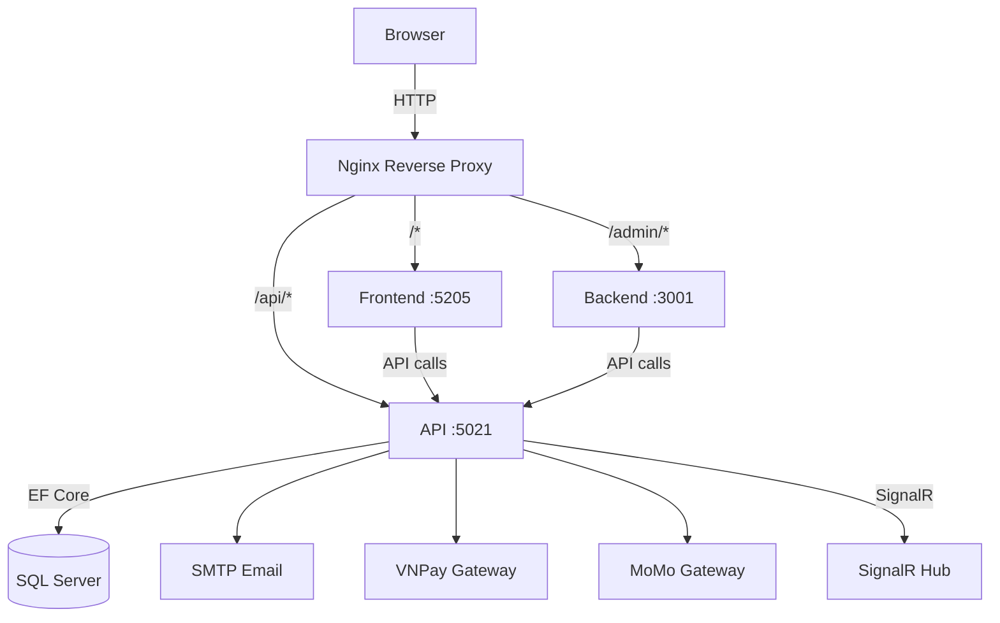
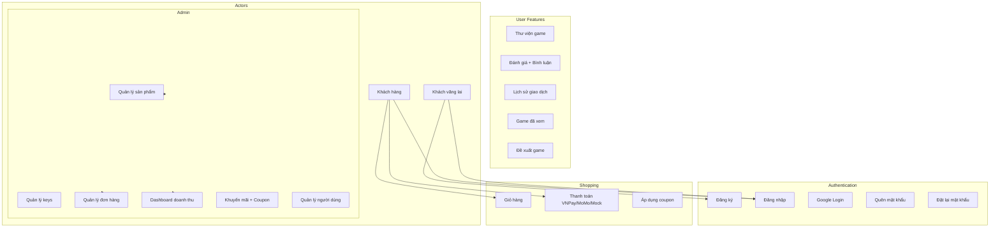

# 📋 GEMINI.md - GAME STORE NEXUS (Complete Project Documentation)

> **Single source of truth** cho toàn bộ project - bao gồm kiến trúc, use cases, API docs, database, deployment, và audit/optimization history.

---

## 📘 1. TỔNG QUAN DỰ ÁN

### 1.1 Giới thiệu
**GameStore** (Nexus Store) là nền tảng thương mại điện tử chuyên phân phối game kỹ thuật số, hỗ trợ thanh toán VNPay/MoMo/MockGateway, quản lý sản phẩm, đơn hàng, mã game (keys), khuyến mãi, coupon, tin tức, đánh giá, hỗ trợ khách hàng và dashboard quản trị.

### 1.2 Tech Stack
| Công nghệ | Mục đích |
|-----------|----------|
| .NET 10 | Runtime |
| ASP.NET Core Minimal API | REST API |
| Blazor Server | Frontend client |
| ASP.NET Core MVC | Admin dashboard |
| EF Core 10 | ORM |
| SQL Server (LocalDB) | Database |
| JWT Bearer + Refresh Token | Auth |
| SignalR | Real-time notifications |
| Chart.js | Dashboard charts |
| Tailwind CSS + Alpine.js | UI styling |
| VNPay/MoMo API | Payment gateways |
| Google OAuth | Social login |
| SMTP (MailKit) | Email service |

### 1.3 Cấu trúc thư mục
```
d:\DA/
├── API/                    # REST API (Minimal API, port 5021)
│   ├── Endpoints/          # 17 endpoint files
│   ├── Services/           # Business logic
│   ├── Hubs/               # SignalR hubs
│   ├── Entities.cs         # ~30 entity models
│   ├── GameStoreDbContext.cs
│   └── Program.cs
├── frontend/               # Blazor Server (port 5205)
│   ├── Components/Pages/
│   ├── Services/
│   ├── ViewModels/
│   └── Program.cs
├── backend/                # MVC Admin (port 3001)
│   ├── Controllers/        # 13 controllers
│   ├── Views/
│   ├── Models/
│   └── Program.cs
├── GameStore.Tests/        # Unit + Integration tests
├── AdminSeeder/            # Database seeder
├── MediaStorage/           # Uploaded files
├── Dockerfile.api/frontend/backend
├── docker-compose.yml
├── nginx.conf
└── deploy.sh
```

---

## 🏗️ 2. KIẾN TRÚC HỆ THỐNG



---

## 👥 3. USE CASE DIAGRAM



---

## 📊 4. DATABASE SCHEMA

### 4.1 Entity Relationships
```
User (30+ relationships)
├── 1:N → Review, ReviewComment, License, Order, Transaction
├── 1:N → Notification, RefreshToken, Wishlist, CartItem
├── 1:N → Product (as Developer), NewsArticle (as Author)
├── 1:N → SupportTicket, PasswordResetToken
└── N:1 → Role

Product
├── N:N → Category (via ProductCategory)
├── N:N → Promotion (via ProductPromotion)
├── 1:N → Release, Review, License, ProductMedia
├── 1:N → ProductKey, SystemRequirement, OrderItem
└── 1:N → Wishlist, CartItem

Order
├── 1:N → OrderItem, ProductKey, Transaction
```

### 4.2 Tables (30 tables)
| # | Table | Description |
|---|-------|-------------|
| 1 | Users | Tài khoản |
| 2 | Roles | Phân quyền |
| 3 | Products | Sản phẩm game |
| 4 | Categories | Danh mục |
| 5 | ProductCategories | N-N Product-Category |
| 6 | Promotions | Khuyến mãi |
| 7 | ProductPromotions | N-N Product-Promotion |
| 8 | ProductKeys | Mã game |
| 9 | Orders | Đơn hàng |
| 10 | OrderItems | Chi tiết đơn |
| 11 | Transactions | Giao dịch |
| 12 | Reviews | Đánh giá |
| 13 | ReviewComments | Bình luận |
| 14 | Licenses | Giấy phép |
| 15 | Coupons | Mã giảm giá |
| 16 | NewsArticles | Tin tức |
| 17 | SupportTickets | Hỗ trợ |
| 18 | PasswordResetTokens | Reset password |
| 19 | RecentlyViewed | Game đã xem |

---

## 🌐 5. API ENDPOINTS (~80+ endpoints)

### 5.1 Authentication
| Method | Endpoint | Auth | Description |
|--------|----------|------|-------------|
| POST | `/api/auth/register` | No | Đăng ký |
| POST | `/api/auth/login` | No | Đăng nhập |
| POST | `/api/auth/google-login` | No | Google OAuth |
| POST | `/api/auth/forgot-password` | No | Gửi email reset |
| POST | `/api/auth/reset-password` | No | Đặt lại mật khẩu |
| POST | `/api/auth/logout` | Yes | Đăng xuất |
| POST | `/api/auth/refresh` | No | Refresh JWT |

### 5.2 Products
| Method | Endpoint | Auth | Description |
|--------|----------|------|-------------|
| GET | `/api/products` | No | Danh sách (phân trang, search, filter, sort) |
| GET | `/api/products/{id}` | No | Chi tiết |
| GET | `/api/products/trending` | No | Trending (bán chạy) |
| POST | `/api/products` | Admin | Tạo mới |
| PUT | `/api/products/{id}` | Admin | Cập nhật |
| DELETE | `/api/products/{id}` | Admin | Xóa |

### 5.3 Orders & Checkout
| Method | Endpoint | Auth | Description |
|--------|----------|------|-------------|
| GET | `/api/orders` | Admin | Danh sách (phân trang) |
| GET | `/api/orders/{id}` | Yes | Chi tiết |
| GET | `/api/orders/my-orders` | Customer | Đơn hàng của tôi |
| GET | `/api/orders/library` | Customer | Thư viện game |
| POST | `/api/orders/checkout` | Customer | Thanh toán |
| PUT | `/api/orders/{id}/status` | Admin | Cập nhật trạng thái |
| GET | `/api/orders/vnpay-return` | No | VNPay callback |
| POST | `/api/orders/momo-notify` | No | MoMo webhook |

### 5.4 Reviews
| Method | Endpoint | Auth | Description |
|--------|----------|------|-------------|
| GET | `/api/reviews/product/{productId}` | No | Đánh giá sản phẩm |
| POST | `/api/reviews` | Customer | Tạo đánh giá |
| PUT | `/api/reviews/{id}` | Customer | Sửa |
| DELETE | `/api/reviews/{id}` | Customer/Admin | Xóa |
| PUT | `/api/reviews/{id}/hide` | Admin | Ẩn/Hiện |
| POST | `/api/reviews/{id}/comments` | Customer | Bình luận |
| GET | `/api/reviews/admin/all` | Admin | Tất cả (phân trang) |

### 5.5 Other Endpoints
| Module | Endpoints | Description |
|--------|-----------|-------------|
| Users | `/api/users` | CRUD + toggle-lock |
| Keys | `/api/keys` | CRUD + generate |
| Promotions | `/api/promotions` | CRUD |
| Coupons | `/api/coupons` | CRUD + apply |
| News | `/api/news` | CRUD |
| Media | `/api/upload` | Upload file |
| Support | `/api/support` | CRUD + reply |
| Admin | `/api/admin/dashboard`, `/api/admin/chart-data` | Dashboard stats |
| Wallet | `/api/wallet` | Deposit + history |
| Wishlist | `/api/wishlist` | CRUD |
| Recommendations | `/api/recommendations`, `/api/recommendations/trending` | Game đề xuất |
| Profile | `/api/users/profile`, `/api/users/change-password` | User profile |

---

## 🖥️ 6. FRONTEND (Blazor Server)

### 6.1 Pages
| Route | Component | Description |
|-------|-----------|-------------|
| `/` | Home.razor | Trang chủ, trending, recommendations |
| `/products/{id}` | ProductDetail.razor | Chi tiết + reviews |
| `/cart` | Cart.razor | Giỏ hàng |
| `/checkout` | Checkout.razor | Thanh toán (chọn gateway) |
| `/checkout/success` | CheckoutSuccess.razor | Kết quả |
| `/login` | Login.razor | Đăng nhập |
| `/register` | Register.razor | Đăng ký |
| `/forgot-password` | ForgotPassword.razor | Quên mật khẩu |
| `/reset-password` | ResetPassword.razor | Đặt lại |
| `/library` | Library.razor | Thư viện game |

### 6.2 Services
| Service | Description |
|---------|-------------|
| AuthService | HTTP calls cho auth API |
| ReviewService | CRUD đánh giá |
| OrderService | Checkout + order history |
| RecommendationService | Lấy game đề xuất |
| RecentlyViewedService | LocalStorage tracking |

---

## 🎛️ 7. BACKEND ADMIN (MVC)

### 7.1 Controllers
| Controller | Route | Description |
|-----------|-------|-------------|
| HomeController | `/` | Dashboard + Chart.js |
| ProductsController | `/Products` | CRUD sản phẩm |
| OrdersController | `/Orders` | Danh sách + chi tiết + update status |
| UsersController | `/Users` | Quản lý người dùng |
| KeysController | `/Keys` | Quản lý product keys + generate |
| PromotionsController | `/Promotions` | CRUD khuyến mãi |
| CouponsController | `/Coupons` | CRUD coupon |
| NewsController | `/News` | CRUD tin tức |
| CommentsController | `/Comments` | Quản lý bình luận |
| SupportController | `/Support` | Quản lý hỗ trợ + reply |
| MediaController | `/Media` | Upload + quản lý media |
| PaymentConfigsController | `/PaymentConfigs` | Cấu hình gateway |
| TransactionsController | `/Transactions` | Lịch sử giao dịch |

---

## 🧪 8. TESTING

### 8.1 Unit Tests (41 passed)
| Test Class | Tests | Description |
|-----------|-------|-------------|
| RecommendationServiceTests | 15 | Recommendation algorithms |
| RecentlyViewedServiceTests | 23 | Recently viewed cache |
| AuthServiceTests | 3 | Auth business logic |

### 8.2 Integration Tests
| Test Class | Description |
|-----------|-------------|
| GameStoreApiFactory | WebApplicationFactory setup |
| ApiEndpointsTests | API endpoint tests |

---

## 🚀 9. DEPLOYMENT

### 9.1 Local Development
```bash
# Terminal 1
start "API" /d d:\DA\API dotnet run --launch-profile http

# Terminal 2
start "Frontend" /d d:\DA\frontend dotnet run --launch-profile http

# Terminal 3
start "Backend" /d d:\DA\backend dotnet run --launch-profile http
```

### 9.2 Docker Compose
```yaml
services:
  api:       build: ./API        (port 5021)
  frontend:  build: ./frontend   (port 5205)
  backend:   build: ./backend    (port 3001)
  nginx:     build: ./           (port 80/443)
```

### 9.3 Production (VPS)
```bash
chmod +x deploy.sh
./deploy.sh  # Build + push + SSH deploy
sudo certbot --nginx -d nexusstore.com
```

---

## 🔒 10. SECURITY

- **Authentication**: JWT (15 min) + Refresh Token (7 days)
- **Authorization**: Policy-based (`RequireRole("Administrator")`)
- **Password**: BCrypt hashing
- **Payment**: HMAC-SHA512 (VNPay), HMAC-SHA256 (MoMo)
- **Protection**: SQL injection (EF Core), XSS (Razor encoding), CSRF (Antiforgery)

---

## 💳 11. PAYMENT GATEWAYS

### 11.1 VNPay
- Sandbox API, Redirect URL, HMAC-SHA512
- Callback: `GET /api/orders/vnpay-return`

### 11.2 MoMo
- Partner API, QR/URL, HMAC-SHA256
- Webhook: `POST /api/orders/momo-notify`

### 11.3 MockGateway
- Dev testing, instant complete

---

## ⚡ 12. REAL-TIME (SignalR)
```
Hub: /hubs/nexus
Events: ReceiveNewOrder
```
- Broadcast khi có đơn hàng mới
- Admin dashboard update real-time

---

## ✅ 13. PROJECT PHASES STATUS

| Phase | Description | Status |
|-------|-------------|--------|
| Phase 1 | Reviews (API + FE + BE) | ✅ Complete |
| Phase 2 | Payment (VNPay/MoMo/Checkout) | ✅ Complete |
| Phase 3 | Auth (Login/Register/Reset Password) | ✅ Complete |
| Phase 4 | Coupons + Media + Dashboard + Promotions | ✅ Complete |
| Phase 5 | Email + Recently Viewed + Recommendations | ✅ Complete |
| Phase 6 | Testing (Unit + Integration) | ✅ Complete |
| Phase 7 | UI Polish (Mobile sidebar, animations) | ✅ Complete |
| Phase 8 | Pagination (Orders, News, Keys) | ✅ Complete |
| Phase 9 | Production Deploy (CI/CD, Docker, VPS, SSL) | ⏳ Pending |
| Phase 10 | Admin Dashboard Enhancements (News CRUD Markdown, Image Upload, UI Polish) | ✅ Complete |

---

## 🔧 14. CODE OPTIMIZATION HISTORY

### Audit Date: 26-27/06/2026
**Total Issues Found**: 16  
**Fixed**: 12 (75%)  
**Remaining**: 4 (optional - P2/P3 low priority)

### ✅ Fixed Issues (12/16)

| Priority | Issue | Solution | Impact |
|----------|-------|----------|--------|
| 🔴 P0 | Hardcoded URLs | `AppSettings:FrontendBaseUrl` + DI config | Production-ready URLs |
| 🔴 P0 | N+1 Query Checkout | `CompleteOrder()` batch helper | Performance -60-80% |
| 🔴 P0 | UserId Duplication | `ClaimsPrincipalExtensions.GetUserId()` | DRY: 10+ → 1 |
| 🔴 P0 | Debug Endpoints | Admin auth check | Security fix |
| 🟡 P1 | Coupon Race Condition | Increment only on success | Bug fix |
| 🟡 P1 | Status Strings | `NormalizeOrderStatus()` | Consistency |
| 🟡 P1 | Dead Code | Removed commented auth | Clean code |
| 🟡 P1 | Misnamed Variable | `newUsers` → `customerCount` | Clarity |
| 🟢 P2 | Discount Duplication | `ProductExtensions.GetActiveDiscountPercent/Price()` | DRY: 6 → 2 |
| 🟢 P2 | ImageUrl Duplication | `ProductExtensions.GetCoverImageUrl()` | DRY: 4 → 1 |
| 🟢 P2 | Transaction Dup | `CreateTransaction()` helper | DRY: 3 → 1 |
| ⚪ P3 | Review Route Conflict | `/product/{id}` + pagination | Bug fix |

### ⏳ Remaining Issues (4/16)
- 🟢 P2: Pagination Inconsistency (1h)
- ⚪ P3: Google OAuth Error Handling (1h)
- ⚪ P3: Wallet Checkout Integration (4h)
- ⚪ P3: Unused Imports Cleanup (10m)

### 📊 Code Quality Metrics
- **Files Modified**: 10 files
- **Lines Changed**: ~250 dòng
- **Performance Gain**: Checkout query giảm 60-80%
- **DRY Improvements**: 
  - UserId parsing: 10+ → 1 extension
  - Discount logic: 6 → 2 extensions
  - ImageUrl: 4 → 1 extension
  - Transaction: 3 → 1 helper

---

## 📁 15. KEY FILES REFERENCE

### Core API Files
| File | Description |
|------|-------------|
| `API/Entities.cs` | 30+ entity models + extensions |
| `API/GameStoreDbContext.cs` | EF Core DbContext |
| `API/Program.cs` | App entry + DI |
| `API/Endpoints/OrderEndpoints.cs` | Orders + Checkout + Payment |
| `API/Endpoints/ProductEndpoints.cs` | Products CRUD |
| `API/Endpoints/AuthEndpoints.cs` | Authentication |
| `API/Services/VnPayService.cs` | VNPay integration |
| `API/Services/MoMoService.cs` | MoMo integration |
| `API/Services/EmailService.cs` | SMTP email |

### Frontend Files
| File | Description |
|------|-------------|
| `frontend/Program.cs` | Blazor app entry |
| `frontend/Services/OrderService.cs` | Checkout logic |
| `frontend/ViewModels/CheckoutViewModel.cs` | Checkout UI logic |
| `frontend/Components/Pages/Home.razor` | Homepage |

### Backend Files
| File | Description |
|------|-------------|
| `backend/Program.cs` | MVC app entry |
| `backend/Controllers/OrdersController.cs` | Order management |
| `backend/Views/Shared/_Layout.cshtml` | Admin layout |
| `backend/Controllers/BaseController.cs` | Base controller |
| `backend/Views/News/*` | News CRUD with Markdown & Image upload |

---

## 🚀 16. SERVICES (Current)

```bash
API:       http://localhost:5021  ✅ (200 OK)
Frontend:  http://localhost:5205  ✅ (200 OK)
Backend:   http://localhost:3001  ✅ (302 Redirect)
```

---

## 📚 17. DOCUMENTATION FILES

| File | Purpose |
|------|---------|
| `project.md` | Full system design (use cases, ERD, API docs) |
| `gemini.md` | **THIS FILE** - Complete project reference |
| `plan.md` | Project roadmap + phase status |
| `task.md` | Task checklist |

---

*Last updated: 27/06/2026 - 14:25*  
*GameStore Nexus - Complete Project Documentation*